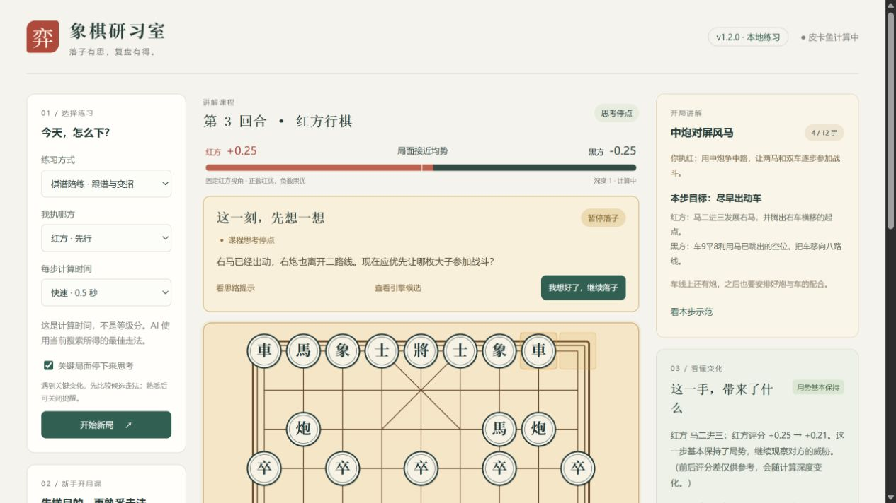

# 象棋研习室

面向个人学习的本地象棋工具：和皮卡鱼下棋、跟开局课程理解每步目的、在关键局面停下来思考，并在对弈中持续查看红黑优劣。

当前版本 **v1.2.0**，提供 Windows 免安装整合包，下载与版本说明见 [Releases](https://github.com/xxzzh/xiangqi/releases)。



## 首次安装（Windows）

普通用户请选择 **[xiangqi-study-v1.2.0-windows-x64.zip](https://github.com/xxzzh/xiangqi/releases/download/v1.2.0/xiangqi-study-v1.2.0-windows-x64.zip)**，不要选 GitHub 自动生成的 Source code。

1. 将整个 ZIP 解压到“文档”、桌面等自己有写入权限的位置。
2. 双击 **`启动研习室.cmd`**，浏览器会自动打开本地棋盘。
3. 选择课程并点击“开始讲解课程”，或选择引擎陪练。

面向 **Windows 10/11 x64（Intel/AMD 64 位）**，无需管理员权限，无需安装 Node.js、npm 或单独下载引擎，首次启动也无需联网。训练页面需要本机已有的现代浏览器。32 位 Windows 和原生 ARM64 不适用此包。

双击 **`停止研习室.cmd`** 完全结束本目录后台服务。重复启动会复用本目录的服务；端口被别的软件或别的副本占用时，会选择附近空闲端口，不会停止其他程序。

学习记录保存在浏览器和本地网址对应的存储中，换浏览器、端口或清除站点数据可能看不到原记录。升级前先导出重要 PGN、停止旧版，再完整解压新版；尽量使用同一浏览器和网址。整合包内的 `开始使用.txt` 提供使用说明与常见问题。

整合包附带官方皮卡鱼与 NNUE，其独立许可条款、作者信息、对应引擎源码及 Node.js/依赖许可均已保留，详见 [THIRD_PARTY.md](THIRD_PARTY.md)。

## 源码运行（开发者）

源码 ZIP 与仓库克隆仍需 Node.js 18 或更高版本，以及皮卡鱼 Windows 引擎与对应 NNUE 权重；建议使用当前受支持的 Node.js LTS。

```powershell
git clone https://github.com/xxzzh/xiangqi.git
cd xiangqi
npm.cmd ci --omit=dev
```

从 [Pikafish 2026-09-06 官方发布页](https://github.com/official-pikafish/Pikafish/releases/tag/Pikafish-2026-09-06) 下载发布包，解压后在项目根目录创建 `engine/`，放入 `Pikafish-Windows-x86-64-universal.exe`、`pikafish.nnue`、`Copying.txt`、`NNUE-License.md` 和 `AUTHORS`。然后按下方说明启动。

Git 仓库和源码 ZIP 包含应用源码、示例棋谱和测试；引擎、权重与运行环境通过 Release 的 Windows 整合包单独分发，本机运行记录不上传。

## 打开

完成安装或解压后，双击 **`启动研习室.cmd`**，浏览器会打开本地棋盘，默认地址 **http://127.0.0.1:3000**。端口冲突时以启动窗口显示的网址为准。

也可以在本目录运行：

```powershell
npm.cmd start
```

命令行启动时用 Ctrl+C 关闭；一键启动的后台服务可双击 `停止研习室.cmd` 或通过 PowerShell 运行 `停止研习室.ps1` 关闭。
引擎只在有棋盘页面连接时运行。关闭所有棋盘页面后，引擎进程会自动退出。

## 建议的练习顺序

1. 新手先选“中炮对屏风马”，点“开始讲解课程”，先执红，计算时间用默认 1.5 秒。熟悉后换执黑，再尝试仙人指路与飞相。
2. 看棋盘上方的评分和局势条；它始终采用红方视角，翻转棋盘不会改变正负含义。黑方数字是同一评分的相反数。
3. 需要帮助时打开“显示提示”，查看前三条候选走法和后续变化。
4. 留意“这一手，带来了什么”。实战时保留你最近一手的反馈；复盘时反馈所选着法。
5. 用“悔棋重练”退回自己走棋前；用棋谱中的着法或左右箭头逐步回看。回看会暂停 AI。
6. 点“从这个局面继续下”会舍弃该位置之后的练习着法，从这里重新尝试；需要保留原局时先导出。

## 带讲解的开局课程

内置 **中炮对屏风马、仙人指路、飞相开局** 三节入门课，每节 6 回合（双方合计 12 手）。

- 点“开始讲解课程”，右侧会展示你执这一方的学习目标、本步目标、刚才双方着法的目的，以及常见误区。
- 默认先自己选棋；需要帮助时点“看本步示范”，显示本课示范着法。示范不是强制落子，仍可尝试其他合法走法。
- 每方各有两个预设思考停点。先回答局面问题，再看思路提示或引擎候选；点“我想好了，继续落子”后继续。
- 偏离课程后由皮卡鱼应招，也可点“回到课程主线”退回偏离前的局面。该操作会舍弃后续着法，需要保留时先导出。
- 完成 12 手后暂停，展示本课要点并记录演练次数。点“从这里继续实战”进入引擎陪练，或者换一方重学。

课程讲解为本项目原创，主线是用于理解出子、腾路、炮架与子力配合的演练示例，不是唯一最优变化，也不是名家实战棋谱。完成次数表示练过，不代表已经掌握全部变招。

## 关键局面停下来思考

默认开启“关键局面停下来思考”。只在轮到你、处于最新实战局面时提醒，自由分析和历史复盘不会自动打断。

触发条件包括：课程预设停点、首次脱离课程、被将军、刚发生车马炮的吃子、新出现直接吃车马炮的合法着法、引擎找到己方杀棋，以及计算完成后前两条候选普通评分相差至少 1.20（深度至少 8，深度差不超过 1）。这些条件是练习用的提醒，不能识别所有妙手或困难局面。

停点会暂停落子并收起候选答案，红黑评分继续更新。可以先独立比较至少两种走法，再选择“看思路提示”或“查看引擎候选”。确认后同一局面不会重复打断；熟悉的内容可关闭提醒。刷新会保留未完成的停点和已看的提示。

## 走法反馈与错题本

“这一手，带来了什么”现在会显示走法标签，并按棋盘规则说明吃子、将军、解将、兵卒过河，以及对方是否有合法着法直接吃到刚走的子。这些说明仅描述可核对的局面事实；有直接吃子的走法并不代表一定值得吃，还要检查交换后的变化。

点“对照当时推荐”可查看落子前引擎计算的推荐变化。旧版本保存的局面可能没有推荐变化，可以回看上一局面重新分析补齐。

- 点“收藏这一步”可保存任意值得研究的着法，不要求已有评分。
- 走棋前后两次计算都完成、普通评分下降至少 1.50，且与当时引擎首选不同的**人类着法**会自动收录。杀棋分数、未算完的局面不会按普通分差自动分类。
- 错题本最多保留 100 个局面，重复收藏不会增加副本；打开后可查看练习次数，并移除条目。
- 点“重练这个局面”会恢复到落子前，隐藏候选提示，并保留完整原局。点棋盘上方“回到原局”返回；重练期间刷新页面仍能返回。
- 评分比较和走法标签是学习参考。两次搜索可能深度不同，因此自动收录适合作为待复习提示。

错题本独立保存在当前浏览器；开始新局不会清空错题。练习期间如选择新局或导入其他棋谱，会提示替换当前练习和暂存的原局。

## 棋谱陪练

- 内置三条主线与上述课程共用走法；“仅跟谱练习”适合熟悉后的快速演练，不显示课程讲解。
- AI 在你仍按谱走时跟随谱招；偏离或走完棋谱后改用皮卡鱼计算，并显示提示。
- 可以执红或执黑。换边不会改变当前局面，只改变哪一方由 AI 控制。
- 导入支持坐标 PGN、含 FEN 初始局面的 PGN，以及空格分隔的中文着法。例如：

```text
炮二平五 马8进7 马二进三 车9平8
```

或使用 `examples/中炮练习.pgn`。PGN 有嵌套变着时只取主线；非法着法会整份拒绝，不会只导入前半盘。
目前不支持 XQF / CBR 二进制文件，请先用原工具转成文本 PGN。

## 评分与规则的范围

- 评分来自真实皮卡鱼搜索，不是预设数字，也不是胜率；数值按引擎 cp / 100 展示，不应直接解释为多一个兵。
- “当前最佳”是给定计算时间内的搜索结果，不是数学证明的最优解。计算时间不是难度或等级分。
- 前后评分差是学习参考，会随深度改变。走法说明来自规则验证，复杂战术请结合推荐变化逐步核对。
- 走法校验包含蹩马腿、塞象眼、炮架、将帅照面、自将与无合法着法判负。
- 三次重复局面会暂停练习，允许悔棋变招。当前版本没有完整实现不同竞赛规则中的长将长捉责任裁定，不可用作正式比赛裁判。
- 内置棋谱是短线示例；名局学习可导入你自己的棋谱。暂不含在线名局检索服务。

## 保存

本局、评分记录、设置、当前课程或训练棋谱、课程完成次数、思考停点、错题本与重练前的原局保存在当前浏览器的 localStorage。刷新后恢复，已有着法时默认暂停，避免自动落子；未完成的思考停点可确认后直接继续。
切换浏览器或清除站点数据不会保留这些记录；用“导出”保存坐标 PGN。新局、导入会提示是否替换当前练习。

## 开发与验证

Node.js 18+。运行 `npm.cmd ci --omit=dev` 安装网页服务依赖，不需要 Electron。
运行 `npm.cmd test` 检验走法、导入、评分方向、走法事实、课程主线与炮线安全、思考停点与恢复、错题去重与重练返回、真实引擎流式响应、取消旧请求及多页面隔离。引擎集成测试需要先按上文安装皮卡鱼与 NNUE。
服务仅监听 `127.0.0.1`，不同页面拥有独立引擎进程，最多同时四个棋盘。
服务器保留“初始局面 + 历史着法”发送给引擎，避免仅用当前 FEN 丢失重复局面历史。

### 构建 Windows 整合包

在 Windows 上运行 `npm.cmd run build:portable`。构建脚本会下载并校验固定版本的官方 Node.js、皮卡鱼发布包和对应源码，仅安装锁文件中的生产依赖，并收集原始许可。下载缓存位于 `.runtime/portable-cache/`，输出 ZIP 与 SHA256 位于 `dist/`；这些目录不会上传到 Git。

运行 `npm.cmd run test:portable -- dist/xiangqi-study-v1.2.0-windows-x64.zip` 对实际 ZIP 重新解压验收：移除 PATH 中的 Node/npm，注入无效外部引擎配置，测试包含中文、空格和 `&` 的目录、端口避让、重复启动、真实引擎搜索、停止子进程和缺失文件提示。此测试使用系统 Windows PowerShell 5.1。

目前通过本机上述隔离运行测试与浏览器训练验收；尚未在独立全新 Windows 虚拟机或所有 Windows 硬件上实测。

本机 `engine/` 放置：

```text
Pikafish-Windows-x86-64-universal.exe
pikafish.nnue
Copying.txt
NNUE-License.md
AUTHORS
```

引擎缺失时从 [Pikafish 2026-09-06 官方发布页](https://github.com/official-pikafish/Pikafish/releases/tag/Pikafish-2026-09-06) 下载并解压相应文件。
可用环境变量 `ENGINE_PATH` 和 `NNUE_PATH` 指定其他引擎路径。

基础界面和规则来自 [vinybnb/xiangqi](https://github.com/vinybnb/xiangqi)（MIT）。
引擎与 NNUE 的版本、来源和许可见 [THIRD_PARTY.md](THIRD_PARTY.md)。
