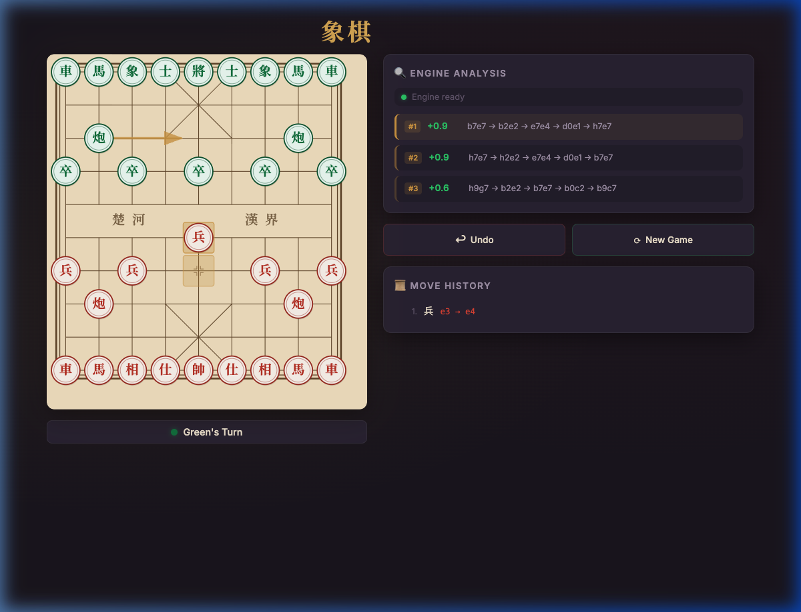

# 象棋 Xiangqi — Chinese Chess with AI

A beautiful Chinese Chess (Xiangqi) application powered by the **Pikafish** AI engine — the strongest open-source Xiangqi engine in the world.



## ✨ Features

- 🎮 **Full Xiangqi rules** — all piece movements, check detection, flying general rule
- 🤖 **AI Analysis** — top 3 best moves powered by Pikafish (NNUE-based engine)
- 🏹 **Move arrows** — visual arrows showing the engine's recommended moves
- ↩️ **Undo** — revert any move
- 🔄 **Flip board** — play from Red or Green's perspective
- 🏆 **Game-over detection** — checkmate and perpetual check/repetition rules
- 🎨 **Premium dark theme** — Chinese-inspired design with glassmorphism effects

## 🏗️ Architecture

| Layer | Technology |
|-------|-----------|
| Engine | [Pikafish](https://github.com/official-pikafish/Pikafish) (UCI protocol) |
| Backend | Node.js + Express + WebSocket |
| Frontend | Vanilla HTML/CSS/JS with SVG board |
| Desktop | Electron (macOS/Windows/Linux) |

---

## 🚀 Quick Start (Web)

### Prerequisites

- [Node.js](https://nodejs.org/) 18+ installed
- A compiled Pikafish binary for your platform

### 1. Clone and install

```bash
git clone https://github.com/YOUR_USERNAME/xiangqi.git
cd xiangqi
npm install
```

### 2. Get the Pikafish engine

You need two files in the project root:

- `pikafish` — the engine binary
- `pikafish.nnue` — the neural network file

#### macOS (Apple Silicon)
```bash
# Compile from source
git clone https://github.com/official-pikafish/Pikafish.git /tmp/pikafish-src
cd /tmp/pikafish-src/src
make -j$(sysctl -n hw.ncpu) build ARCH=apple-silicon
cp pikafish /path/to/xiangqi/pikafish

# Download NNUE file
curl -L -o /path/to/xiangqi/pikafish.nnue \
  https://github.com/official-pikafish/Networks/raw/master/pikafish.nnue
```

#### macOS (Intel)
```bash
cd /tmp/pikafish-src/src
make -j$(sysctl -n hw.ncpu) build ARCH=x86-64-modern
```

#### Linux
```bash
cd /tmp/pikafish-src/src
make -j$(nproc) build ARCH=x86-64-modern
cp pikafish /path/to/xiangqi/pikafish
```

#### Windows
```bash
# Using MSYS2/MinGW
cd /tmp/pikafish-src/src
make -j build ARCH=x86-64-modern
# Copy pikafish.exe to the project root
```

Or download a pre-built binary from the [Pikafish releases](https://github.com/official-pikafish/Pikafish/releases).

### 3. Run the web server

```bash
npm start
```

Open **http://localhost:3000** in your browser.

---

## 🖥️ Build Desktop App (Electron)

### macOS

```bash
npm install
npm run build
# Output: dist/mac-arm64/象棋 Xiangqi.app

# Launch it
open "dist/mac-arm64/象棋 Xiangqi.app"
```

> **Note:** The build is unsigned. On first launch, right-click → Open to bypass Gatekeeper.

### Windows

```bash
# On a Windows machine with Node.js installed
npm install

# Build for Windows
npx electron-builder --win --x64

# Output: dist/win-unpacked/象棋 Xiangqi.exe
```

Make sure you have:
- `pikafish.exe` (Windows build) in the project root
- `pikafish.nnue` in the project root

Update `package.json` build config to include `.exe`:
```json
{
  "build": {
    "win": {
      "target": "dir",
      "icon": "docs/icon.ico"
    },
    "extraResources": [
      { "from": "pikafish.exe", "to": "pikafish" },
      { "from": "pikafish.nnue", "to": "pikafish.nnue" },
      { "from": "public", "to": "public" }
    ]
  }
}
```

Also update `server.js` to detect the platform:
```javascript
// In server.js, update ENGINE_PATH default:
const isWin = process.platform === 'win32';
const ENGINE_PATH = process.env.ENGINE_PATH || path.join(__dirname, isWin ? 'pikafish.exe' : 'pikafish');
```

### Linux

```bash
npx electron-builder --linux --x64
# Output: dist/linux-unpacked/
```

---

## 📁 Project Structure

```
xiangqi/
├── main.js          # Electron main process
├── server.js        # Node.js backend (Express + WebSocket + Pikafish UCI)
├── package.json     # Dependencies and build config
├── pikafish         # Engine binary (not in repo — see setup)
├── pikafish.nnue    # Engine neural network (not in repo — see setup)
├── public/
│   ├── index.html   # Main page
│   ├── style.css    # Dark theme styling
│   └── game.js      # Game logic, SVG board, move validation
├── dist/            # Build output (gitignored)
└── docs/
    └── screenshot.png
```

---

## 🎮 How to Play

1. **Click a piece** to select it — valid moves appear as gold dots
2. **Click a destination** to move the piece
3. The **engine analyzes** the position and shows the top 3 best moves
4. Use **Undo** to take back a move
5. Use **Flip** to rotate the board
6. Use **New Game** to restart

### Xiangqi Rules Quick Reference

| Piece | Chinese | Movement |
|-------|---------|----------|
| General (King) | 帥/將 | One step orthogonally, stays in palace |
| Advisor | 仕/士 | One step diagonally, stays in palace |
| Elephant | 相/象 | Two steps diagonally, cannot cross river |
| Horse | 馬 | L-shape (can be blocked) |
| Chariot (Rook) | 車 | Any number of steps orthogonally |
| Cannon | 炮/砲 | Moves like Rook, captures by jumping over one piece |
| Soldier (Pawn) | 兵/卒 | One step forward; sideways after crossing river |

---

## 🔧 Configuration

Edit `server.js` to adjust engine settings:

```javascript
this.send('setoption name Threads value 2');   // CPU threads
this.send('setoption name Hash value 64');      // Hash table MB
this.send('setoption name MultiPV value 3');    // Number of best lines
```

Analysis depth can be changed:
```javascript
this.send('go depth 15');  // Search depth (higher = stronger but slower)
```

---

## 📄 License

MIT License — free to use, modify, and distribute.

The [Pikafish](https://github.com/official-pikafish/Pikafish) engine is licensed under GPL-3.0.

---

## 🙏 Credits

- **[Pikafish](https://github.com/official-pikafish/Pikafish)** — the strongest open-source Xiangqi engine
- **[Electron](https://www.electronjs.org/)** — desktop app framework
- **[Noto Serif SC](https://fonts.google.com/noto/specimen/Noto+Serif+SC)** — Chinese font by Google
