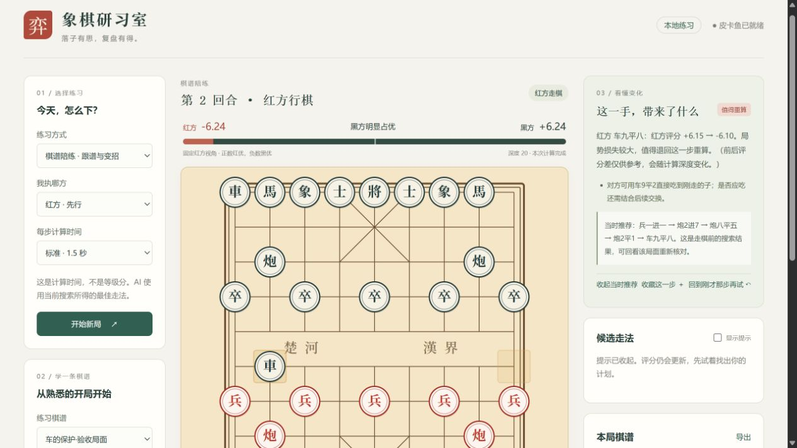

# 象棋研习室

面向个人学习的本地象棋工具：和皮卡鱼下棋、跟指定棋谱练习，并在对弈中持续查看红黑优劣。



## 首次安装（Windows）

需要 Node.js 18 或更高版本，以及皮卡鱼 Windows 引擎与对应 NNUE 权重。

```powershell
git clone https://github.com/xxzzh/xiangqi.git
cd xiangqi
npm.cmd ci --omit=dev
```

从 [Pikafish 2026-09-06 官方发布页](https://github.com/official-pikafish/Pikafish/releases/tag/Pikafish-2026-09-06) 下载发布包，解压后在项目根目录创建 `engine/`，放入 `Pikafish-Windows-x86-64-universal.exe`、`pikafish.nnue`、`Copying.txt`、`NNUE-License.md` 和 `AUTHORS`。然后按下方说明启动。

仓库包含应用源码、示例棋谱和测试；引擎二进制、权重、依赖目录与本机运行记录不随源码上传。

## 打开

完成首次安装后，双击 **`启动研习室.cmd`**，浏览器会打开 **http://127.0.0.1:3000**。

也可以在本目录运行：

```powershell
npm.cmd start
```

命令行启动时用 Ctrl+C 关闭；一键启动的后台服务可通过 PowerShell 运行 `停止研习室.ps1` 关闭。
引擎只在有棋盘页面连接时运行。关闭所有棋盘页面后，引擎进程会自动退出。

## 建议的练习顺序

1. 选择“引擎陪练”，先执红，计算时间用默认 1.5 秒。先想出自己的走法，再落子。
2. 看棋盘上方的评分和局势条；它始终采用红方视角，翻转棋盘不会改变正负含义。黑方数字是同一评分的相反数。
3. 需要帮助时打开“显示提示”，查看前三条候选走法和后续变化。
4. 留意“这一手，带来了什么”。实战时保留你最近一手的反馈；复盘时反馈所选着法。
5. 用“悔棋重练”退回自己走棋前；用棋谱中的着法或左右箭头逐步回看。回看会暂停 AI。
6. 点“从这个局面继续下”会舍弃该位置之后的练习着法，从这里重新尝试；需要保留原局时先导出。

## 走法反馈与错题本

“这一手，带来了什么”现在会显示走法标签，并按棋盘规则说明吃子、将军、解将、兵卒过河，以及对方是否有合法着法直接吃到刚走的子。这些说明仅描述可核对的局面事实；有直接吃子的走法并不代表一定值得吃，还要检查交换后的变化。

点“对照当时推荐”可查看落子前引擎计算的推荐变化。旧版本保存的局面可能没有推荐变化，可以回看上一局面重新分析补齐。

- 点“收藏这一步”可保存任意值得研究的着法，不要求已有评分。
- 走棋前后两次计算都完成、普通评分下降至少 1.50，且与当时引擎首选不同的**人类着法**会自动收录。杀棋分数、未算完的局面不会按普通分差自动分类。
- 错题本最多保留 100 个局面，重复收藏不会增加副本；打开后可查看练习次数，并移除条目。
- 点“重练这个局面”会恢复到落子前，隐藏候选提示，并保留完整原局。点棋盘上方“回到原局”返回；重练期间刷新页面仍能返回。
- 评分比较和走法标签是学习参考。两次搜索可能深度不同，因此自动收录适合作为待复习提示。

错题本独立保存在当前浏览器；开始新局不会清空错题。练习期间如选择新局或导入其他棋谱，会提示替换当前练习和暂存的原局。

## 棋谱陪练

- 内置中炮、仙人指路、飞相三条开局短线，均为合法走法演练示例，不是唯一最优变化，也未冒充名家实战。
- 选谱后点“跟这条谱练习”。AI 在你仍按谱走时跟随谱招；偏离或走完棋谱后改用皮卡鱼计算，并显示提示。
- 可以执红或执黑。换边不会改变当前局面，只改变哪一方由 AI 控制。
- 导入支持坐标 PGN、含 FEN 初始局面的 PGN，以及空格分隔的中文着法。例如：

```text
炮二平五 马8进7 马二进三 车9平8
```

或使用 `examples/中炮练习.pgn`。PGN 有嵌套变着时只取主线；非法着法会整份拒绝，不会只导入前半盘。
目前不支持 XQF / CBR 二进制文件，请先用原工具转成文本 PGN。

## 评分与规则的范围

- 评分来自真实皮卡鱼搜索，不是预设数字，也不是胜率；数值按引擎 cp / 100 展示，不应直接解释为多一个兵。
- “当前最佳”是给定计算时间内的搜索结果，不是数学证明的最优解。计算时间不是难度或等级分。
- 前后评分差是学习参考，会随深度改变。走法说明来自规则验证，复杂战术请结合推荐变化逐步核对。
- 走法校验包含蹩马腿、塞象眼、炮架、将帅照面、自将与无合法着法判负。
- 三次重复局面会暂停练习，允许悔棋变招。当前版本没有完整实现不同竞赛规则中的长将长捉责任裁定，不可用作正式比赛裁判。
- 内置棋谱是短线示例；名局学习可导入你自己的棋谱。暂不含在线名局检索服务。

## 保存

本局、评分记录、设置、当前训练棋谱、错题本与重练前的原局保存在当前浏览器的 localStorage。刷新后恢复，已有着法时默认暂停，避免自动落子。
切换浏览器或清除站点数据不会保留这些记录；用“导出”保存坐标 PGN。新局、导入会提示是否替换当前练习。

## 开发与验证

Node.js 18+。运行 `npm.cmd ci --omit=dev` 安装网页服务依赖，不需要 Electron。
运行 `npm.cmd test` 检验走法、导入、评分方向、走法事实、错题去重与重练返回、真实引擎流式响应、取消旧请求及多页面隔离。
服务仅监听 `127.0.0.1`，不同页面拥有独立引擎进程，最多同时四个棋盘。
服务器保留“初始局面 + 历史着法”发送给引擎，避免仅用当前 FEN 丢失重复局面历史。

本机 `engine/` 放置：

```text
Pikafish-Windows-x86-64-universal.exe
pikafish.nnue
Copying.txt
NNUE-License.md
AUTHORS
```

引擎缺失时从 [Pikafish 2026-09-06 官方发布页](https://github.com/official-pikafish/Pikafish/releases/tag/Pikafish-2026-09-06) 下载并解压相应文件。
可用环境变量 `ENGINE_PATH` 和 `NNUE_PATH` 指定其他引擎路径。

基础界面和规则来自 [vinybnb/xiangqi](https://github.com/vinybnb/xiangqi)（MIT）。
引擎与 NNUE 的版本、来源和许可见 [THIRD_PARTY.md](THIRD_PARTY.md)。
